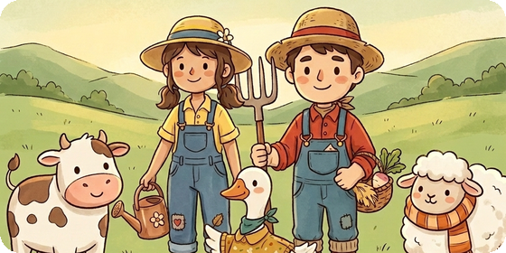
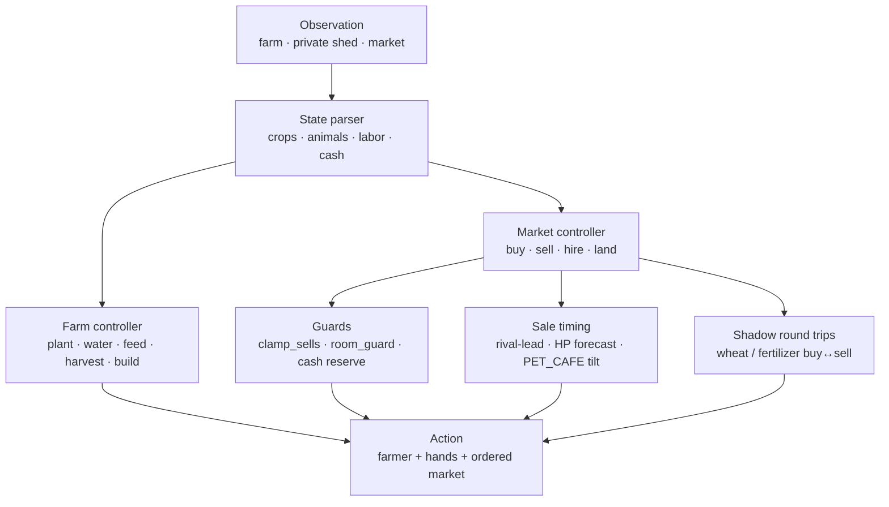

<div align="center">



# Kaggriculture

**Market-aware farming agent for a 720-turn economic simulation**

**Bronze medal · 740 / 10 148 teams · top 7.3%**

Team **MISIS loss volos**: Semyon Morev · Kirill Gerasimov

[Результат](#результат) · [Идея](#идея-в-одном-абзаце) · [Архитектура](#архитектура) · [Эксперименты](#эксперименты) · [Команда](#команда) · [Запуск](#быстрый-старт)

</div>

---

> **TL;DR.** Считаем **разрыв банков** с соперником. В Kaggriculture рынок общий:
> продал меньше — цены выросли — соперник заработал больше. Поэтому «максимизировать свой
> доход» недостаточно. Мы собрали live-пул из Kaggle-дампов, играли парные seed'ы в обоих
> слотах, нашли точку перелома в opening и довели market/farm planner до Bronze.
> Результат: **Bronze medal, 740/10 148**.

---

## Результат

| | |
|---|---|
| **Соревнование** | [Kaggriculture](https://www.kaggle.com/competitions/kaggriculture) — Kaggle Featured Simulation Competition |
| **Команда** | **MISIS loss volos** — Морев Семён (БПМ-25-4-2), Герасимов Кирилл (ББИ-25-6) |
| **Результат** | **Bronze medal**, **740 / 10 148** команд (**top 7.3%**) |
| **Private LB score** | **4450.9** |
| **Public LB score** | 1924.4 (public rank 794) |
| **Финальный сабмит** | 30.09.2026, `v57_plus_open5` |
| **Дедлайн** | 14.10.2026 |
| **Режим** | 1v1, 720 ходов, 30 игровых дней, до 10 market orders/turn |
| **Стек** | Python (stdlib), `kaggle-environments` |

> Public и private LB считаются на разных наборах эпизодов. Итоговое место — по private:
> **740/10 148**, Bronze. Public-скор ниже, потому что public-выборка — другая игра.

В соревновании участвовали **10 148 команд**, призовой фонд — **50 000 USD**. Первое место
набрало **5890.3**; в верхушке — сильные инженерные и RL-команды.

---

## Что такое Kaggriculture

Два игрока ведут фермы на сетке **10×10** и соревнуются, кто больше заработает за сезон.

- **720 ходов** = 24 хода в день × 30 дней.
- У фермера и наёмных рук — **по одному действию за ход**: двигаться, сажать, поливать,
  собирать, кормить, строить, ухаживать за животными.
- До **10 рыночных ордеров за ход**: купить семена/животных/продукт, продать, нанять руку,
  купить землю.
- **Рынок общий и динамический**: цена зависит от суммарного предложения обоих игроков,
  спроса города и открывшихся магазинов.
- Побеждает тот, у кого **больше денег в банке** в конце сезона.

Полные правила, таблицы культур, животных и формула цены: [`docs/GAME_RULES.md`](docs/GAME_RULES.md).

---

## Почему задача сложная

| Сложность | Что это значит для агента |
|---|---|
| **Общий рынок** | Ваши продажи двигают цену для соперника; абсолютный доход и разрыв — разные метрики. |
| **Одно действие на юнита** | Нельзя «сделать всё»: полив, сбор, логистика и стройка конкурируют за ходы. |
| **720 ходов** | Ошибка в opening стоит дорого; поздняя атака по рынку — тоже. |
| **Частичная наблюдаемость** | Свои сарай/семена/инвентарь видны, чужие — нет; ферма соперника видна. |
| **Динамические цены** | Один и тот же товар в разные дни стоит по-разному; надо планировать очередь продаж. |
| **Шум и мета** | Поле меняется за дни: публичные агенты перезаливаются, пул устаревает. |

---

## Идея в одном абзаце

Считаем **разрыв банков**: `наш_банк − банк_соперника`. Рынок общий, поэтому «недопродажа»
поднимает цену сопернику, и абсолютный доход плохо отражает силу агента. Для этого мы
собираем **live-пул** из Kaggle-дампов, играем **парные seed'ы в обоих слотах** и обновляем
пул каждые 2–3 дня. Финальный агент — market/farm planner на публичном Apache-2.0 шасси,
поверх которого добавлены наши слои: opening-последовательность, sale timing, storage guards,
labor rescue и shadow round trips.

---

## Архитектура



Пайплайн одного хода:

1. **Parse.** Ферма, приватный сарай, деньги, очередь рынка, открытые магазины.
2. **Plan production.** Что сажать/поливать/кормить/собирать с учётом ходов юнитов.
3. **Plan market.** Что покупать/продавать, в каком порядке, с учётом цены и места в сарае.
4. **Guard.** Не продать лишнего, не переполнить сарай, не остаться без cash на hire/seed.
5. **Shadow.** Проверить, можно ли выгодно вставить buy/sell round trip в текущую очередь.
6. **Emit.** Одно действие на юнита + упорядоченный список market orders.

---

## Ключевые идеи

### 1. Мерить разрыв банков

В shared-market игре абсолютный банк плохо отражает силу агента. Если я продал меньше, цена
выросла и соперник продал дороже. Поэтому основной прибор:

$$
\text{gap} = \text{bank}_{\text{us}} - \text{bank}_{\text{opp}}
$$

Все решения принимались по `gap` и win rate. На этой метрике ломались интуитивные улучшения:
три приёма подряд поднимали наш банк и ухудшали разрыв.

### 2. Live-пул вместо встроенных агентов

`pass`, `random`, `starter` бесполезны: `starter` за сезон зарабатывает ~551 монету, а живое
поле — сотни тысяч. Мы собираем пул из **Kaggle-дампов эпизодов**:

- выжимаем действия из дампа (~20 ГБ → ~40 МБ);
- строим `corpus/index.csv` и replay-агентов;
- берём сильные и популярные кластеры, а также середняков;
- играем **парные seed'ы**, **оба места**, считаем `gap` с ошибкой по парам;
- обновляем пул каждые 2–3 дня, потому что мета перезаливается.

Урок: **панель соперников протухает за трое суток**. Если пул старый, все числа врут.

### 3. Разложение opening: одна строка стоила ~57k

Мы разложили разрыв на компоненты и обнаружили, что из ~66–84 тысяч разрыва около **57 тысяч**
объяснялись одной строкой **нулевого хода**. Причина — рыночный клик: порядок BUY/SELL на
старте меняет цену и cash, а дальше снежный ком.

Отсюда появились EXP791/792 — точная последовательность opening-ордеров, проверенная на
exact-движке и на живом пуле. По соотношению эффекта к цене это оказался лучший ход кампании.

### 4. Market execution layers

Финальный агент собран из слоёв, каждый из которых проверялся отдельно:

| Слой | Что делает |
|---|---|
| `clamp_sells` | не продаёт больше, чем реально поместится/подтвердится по сараю |
| `room_guard` | держит сарай ≤ 99 к часу 23, чтобы не потерять overflow |
| sale lead | продаёт на ход раньше, если соперник уже начал двигать цену |
| rival-lead learner | запоминает, какие наши лоты соперник перекупил, и сдвигает следующие |
| DPTS execution | рыночные слои исполнения из публичного tetsutani-шасси |
| HP forecast | прогноз продаж соперника на 6–8 ходов вперёд |
| PET_CAFE tilt | сдвиг carrot при открытии Pet Cafe |
| order reorder | переставляет наши price-moving ордера в лучшие слоты |

### 5. Shadow round trips

Отдельный слой ищет **buy↔sell round trip** внутри одного хода: купить/продать wheat или
fertilizer так, чтобы цена сдвинулась в нашу пользу, а cash и место в сарае остались
безопасными. Ход проверяется точной lockstep-симуляцией рынка. Слой срабатывает 4–8 раз
за игру и даёт небольшие, но устойчивые плюсы к банку.

### 6. Storage и labor guards

- `clamp_sells` и `room_guard` не дают потерять товар на переполнении.
- `wheat-seed cap` не даёт купить семян больше, чем можно посадить.
- `starvation rescue` спасает животное, которое уже осталось без еды один день.
- `route remaps` и `weed fix` убирают потери на логистике и сорняках.
- `day-0 cash reserve` не даёт opening-последовательности оставить ферму без cash.

### 7. Перенос слоёв с атрибуцией

Мы использовали публичные Apache-2.0 решения как источник слоёв: ADV/VQ/FRO из
«The Moon Counts Melons» (prvsiyan), HR/HP из «The Shepherd's Ledger» (haideptry),
рыночное исполнение из tetsutani. Каждый слой проверялся на нашем пуле; в финал попали
только те, что дали неотрицательный эффект. Все лицензии и имена авторов сохранены в
`main.py`, `LICENSE` и `NOTICE.md`.

### 8. Упаковка

Финальный `main.py` — **10 774 строки**, self-contained, без внешних зависимостей.
Перед сабмитом мы распаковывали архив и играли полный эпизод **официальным загрузчиком
Kaggle**. Так ловятся две тихие ошибки: отсутствие `__file__` и неверная точка входа.

---

## Эксперименты

### Что сработало

| Слой | Локальный гейт | Результат |
|---|---|---|
| EXP774 ADV/VQ/FRO | pool +5.37 → +6.61 pts | оставили |
| EXP786 DPTS execution | wins 16.36 → 17.25; bank gap 841 → 294 | оставили |
| EXP789 PET_CAFE carrot tilt | +4.2 / +4.0 pts | оставили |
| EXP791/792 opening | pool 18.03 → 18.60 | оставили |
| EXP793/794 shadow round trips | pool 18.60 → 20.48; W→L 92 → 46 | оставили |

Цифры ниже — локальный 61-agent pool. Они показывают направление и воспроизводимость;
финальный LB-скор — в таблице результата.

### Что не сработало

| Линия | Результат | Решение |
|---|---|---|
| BC-клон топ-реплеев | клон = учитель по исходам (0.0σ), преимущества нет | закрыли |
| Больше эпох имитации | меньшая loss → **худший** игрок (−4.0 pp) | закрыли |
| RL через температуру | окна разведки нет, катастрофа при t=2 | закрыли |
| Поиск по открытию | пространство исчерпано; оптимум — узкий пик шириной в один шаг | закрыли |
| Тюнинг чужого шасси | 4 переключателя дают ноль, `budget_guard` вредит | закрыли |

Вывод: **идею нужно проверять игрой**. Мы принимали слой только после парных seed'ов,
двух мест и проверки на свежем пуле. Это спасло от нескольких «побед», которые были шумом.

---

## Команда

| Участник | Роль | Вклад |
|---|---|---|
| **Морев Семён** (БПМ-25-4-2) | Research / strategy | Разведка движка и рынка, методология live-пула, разложение разрыва, гипотезы opening и слоёв, финальная сборка и выбор сабмита. |
| **Герасимов Кирилл** (ББИ-25-6) | ML / infrastructure | BC/entity-ветка, обучение и инфраструктура, независимая проверка, упаковка и воспроизводимость. |

Оба участвовали в код-ревью, запуске экспериментов и разборе результатов; жёсткого
разделения не было.

---

## Структура репозитория

```text
.
├── main.py                     # финальный сабмит v57_plus_open5
├── LICENSE                     # Apache-2.0 (наследие публичного шасси)
├── NOTICE.md                   # авторы и атрибуция upstream
├── assets/
│   └── kaggriculture-header.png
├── docs/
│   ├── GAME_RULES.md           # полные правила и параметры движка
│   ├── POOL.md                 # методология живого пула
│   ├── RESEARCH.md             # разведка движка и рынка
│   └── TOOLS.md                # описание исследовательских инструментов
├── vs_agent.py                 # дуэль: парные seed'ы, оба места, bank gap
├── eval_agent.py               # оценка против пула
├── accept_submission.py        # приёмка официальным загрузчиком
├── divergence.py               # разбор партии по ходам
├── plan_by_seed.py             # какой план выбирается на seed
├── opening_sweep.py            # развёртка opening
├── broad_opening.py            # широкая развёртка opening
├── episode_spread.py           # разброс исходов
├── recon/
│   ├── fastenv.py              # bit-exact быстрый движок
│   ├── pool.py                 # сборка пула из корпуса
│   ├── fetch_pubagents.py      # подтянуть публичных агентов
│   ├── extract_corpus.py       # дамп эпизодов → корпус действий
│   └── make_tape_agent.py      # эпизод → replay-агент
└── requirements.txt
```

---

## Быстрый старт

```bash
python -m venv .venv
source .venv/bin/activate
pip install -r requirements.txt
```

Проверка финального агента в реальном движке:

```python
from kaggle_environments import make

env = make("kaggriculture", configuration={"episodeSteps": 720}, debug=True)
env.run(["main.py", "random"])

print([(i, s.reward, s.status) for i, s in enumerate(env.steps[-1])])
```

Дуэль с парными seed'ами и обоими местами:

```bash
python vs_agent.py --agent main.py --opp random --games 8 --workers 4
```

Приёмка так, как её запускает Kaggle:

```bash
tar -czf submission.tar.gz main.py
python accept_submission.py submission.tar.gz --opponent starter
```

> `recon/pool.py` и `recon/fetch_pubagents.py` требуют `corpus/` и `recon/pubagents/` —
> это данные кампании, они не входят в публичный релиз. Финальный `main.py` работает без них.

---

## Научная честность и attribution

Kaggriculture — игра и движок Kaggle; правила и параметры принадлежат организаторам.

Финальный агент — **производная публичного Apache-2.0 шасси** «Kaggriculture V57 —
Funding-Order Invariant» (Ahmed Berat Özer) и его upstream-линии (Nathan Jacob Pipe16
HybridOpening, Thomas Tschinkel Metav4, Dmitrii Gluzdov, yhay81, prvsiyan, aurax7,
tetsutani, destbreso и др.). Все лицензии и уведомления сохранены в `main.py`, `LICENSE`
и [`NOTICE.md`](NOTICE.md).

Публичный код остаётся за его авторами. Наш вклад:

- методология live-пула и измерение bank gap;
- разложение opening и найденные последовательности;
- sale timing, storage/labor guards, shadow round trips;
- отбор и проверка слоёв на свежем пуле;
- финальная сборка, упаковка и приёмка.

Публичные агенты использовались как соперники и источник идей. Их код перевыкладывается
только с сохранением Apache-2.0 notices.

---

## Ссылки

- [Kaggle: Kaggriculture](https://www.kaggle.com/competitions/kaggriculture)
- [Финальный лидерборд](https://www.kaggle.com/competitions/kaggriculture/leaderboard) — команда `MISIS loss volos`, 740/10 148
- [Правила и параметры движка](docs/GAME_RULES.md)
- [Методология пула](docs/POOL.md)
- [Разведка движка и рынка](docs/RESEARCH.md)

---

<div align="center">
<sub>Собрано для защиты результата и перезачёта. Все ключевые эксперименты и инструменты — в репозитории.</sub>
</div>
